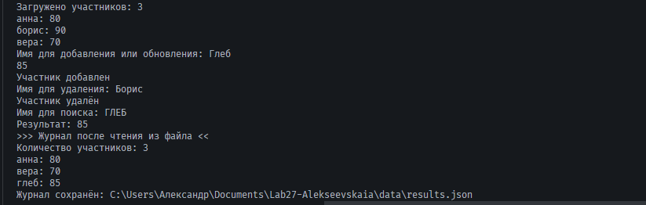

# Практическая работа №27

Автор: Алексеевская Елена

Группа: ИСП-251

## Тема

Сериализация и десериализация JSON в C#.

## Что реализовано

- загрузка словаря из JSON;
- проверка структуры и допустимых значений;
- добавление, обновление, удаление и поиск участника;
- сохранение в UTF-8 с отступами;
- повторное чтение сохранённого файла;
- обработка отсутствующего и повреждённого журнала.

## Короткие ответы

1. Чем сериализация отличается от записи файла?

Ответ: Сериализация превращает данные программы в строку JSON, но файл при этом не создается. Запись файла - отдельное действие: готовая строка кладётся на диск через File.WriteAllText. Поэтому в SaveResults сначала вызывается Serialize, а потом WriteAllText.

2. Почему {}, [] и null нельзя считать одинаковым пустым журналом?

Ответ: {} - пустой объект, он подходит для словаря из нуля пар. [] - пустой массив, другая структура, для Dictionary<string, int> не подходит и даёт JsonException. null - отсутствие значения, при десериализации даёт null вместо коллекции, что по заданию не допускается. Это разные состояния, и программа должна их различать.

3. Почему после ошибки чтения JSON нельзя сразу сохранять пустой словарь в тот же файл?

Ответ: Потому что так уничтожается поврежденный файл, который можно еще исправить вручную, и скрывается ошибка. По заданию при поврежденном JSON нужно сообщить об ошибке и завершить работу, не перезаписывая файл. Пустой словарь допустим только при отсутствии файла, через отдельный catch (FileNotFoundException).

## Файл данных
data/results.json — словарь «имя — результат».
Запускать dotnet run из папки проекта.

## Результат

